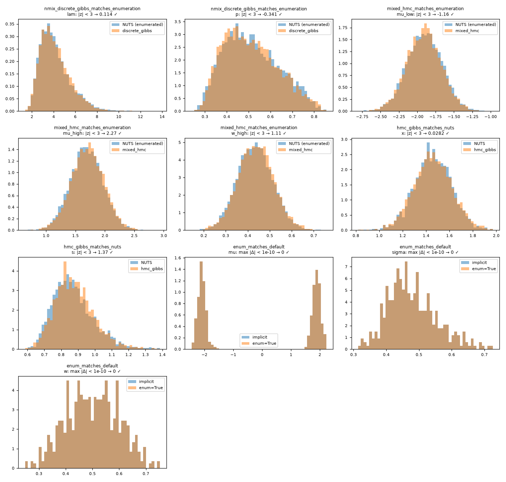
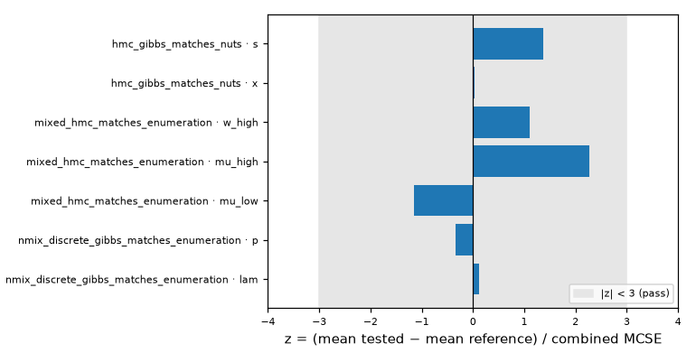

# Verification checks

| Test | Quantity | Reference | Criterion | Value | Result |
|---|---|---|---|---|---|
| `test_r_matches_python` | R: rows differing from Python (sim, rep, N, b, seed, result) | Python run_simulations, serial | == 0 | 0 | ✅ |
| `test_julia_matches_python` | Julia: rows differing from Python (sim, rep, N, b, seed, result) | Python run_simulations, serial | == 0 | 0 | ✅ |

